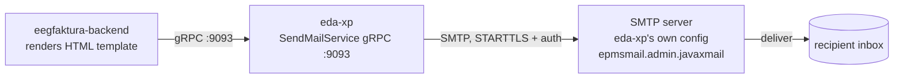

# Notification e-mail flow

How member- and admin-facing notification e-mails (for example metering-point
**activation**, **completion** and **inactive**) are rendered and delivered.

!!! note "Not the same as EDA-over-e-mail"
    This flow is **separate** from `eda-xp`'s EDA-over-e-mail transport (PONTON-MAIL) used for
    market messages. `eda-xp` happens to host both, but they are different code paths — see
    [Messaging](messaging.md) and [services/eda-xp](../services/eda-xp.md).

## Chain

1. **Render** — the backend fills an HTML template with the EEG / participant / metering-point
   data. Templates are looked up under the directory in the config key `file-content.templates`
   (in the cluster `/opt/storage/public`): `<dir>/<tenant>/templates/`, then the global
   `<dir>/templates/`, then the defaults embedded in the binary (`public/templates`).
2. **gRPC hand-off** — the backend has **no direct SMTP path**. It calls the `SendMailService`
   (proto package `at.energydash`) at the config key `services.mail-server` (backend
   `config.yaml`; the env override keeps the hyphen, `VFEEG_BACKEND_SERVICES_MAIL-SERVER`, because
   the key replacer only maps `.`), which points at eda-xp's gRPC port 9093. The gRPC `Sender`
   field carries the **tenant id** (member mails) or `<RC number>@eegfaktura.at` (ZP list mail);
   eda-xp **ignores** it.
3. **SMTP** — `eda-xp` sends the message itself over SMTP with the transport in
   `epmsmail.admin.javaxmail` (STARTTLS + auth; host/port/user via `SMTP_ADMIN_SERVER_HOST`,
   `SMTP_ADMIN_SERVER_PORT`, `EMAIL_ADMIN_USER`, `EMAIL_ADMIN_PWD`). In the GitOps manifests this
   is an external transactional mail service, **not** the in-cluster relay that billing uses.
4. **Delivery** — sent as `From:` `epmsmail.admin.from` (default `no-reply@eegfaktura.at`, env
   `EMAIL_ADMIN_FROM`), `Cc:` the EEG's own office address (`eeg.Email`), `To:` the member.

## Who sends what

| Sender | Path | Examples |
|---|---|---|
| **eegfaktura-backend** | renders a Go `html/template` → gRPC `SendMailService` → eda-xp SMTP | metering-point **activation** ("Aktivierung im Serviceportal"), **completion** ("Dein Zählpunkt ist aktiv"), **inactive** ("Dein Zählpunkt ist nicht mehr Teil der Energiegemeinschaft"); ZP list Excel to the EEG office address (`SendMailWithAttachment`) |
| billing | renders a **FreeMarker** template → its **own** `JavaMailSender`/SMTP (`MAIL_*` env) → in-cluster relay (`eegfaktura-mailbrake` in the GitOps manifests, `eegfaktura-postfix` in docker-compose) | billing documents (PDF attached) |
| energystore | gRPC `ExcelAdminService.SendExcel` on eda-xp's port 9093 | energy Excel report to the requesting user (`POST /eeg/{ecid}/excel/export/{year}/{month}`) |
| keycloak | its own SMTP (configured on the instance; not in `realm/EEGFaktura.yaml`) | password reset, e-mail verification, the "set your password" mail that admin-backend triggers for new accounts (`executeActionsEmail(UPDATE_PASSWORD)`) |

backend and energystore use the gRPC hop through `eda-xp`; billing and keycloak talk SMTP
directly.

!!! note "energystore's Excel mail has no server"
    eda-xp's gRPC server registers only `SendMailService` and `RegisterPontonService`; it does
    not implement `ExcelAdminService`, so energystore's `SendExcel` call fails. Note the template engines differ per sender: the backend uses Go
`html/template` (see [Templates & conventions](#templates-conventions) below), while billing
renders with **FreeMarker** (`BillingEmailDefaultTemplate.ftl`, `MAIL_NO_REPLY_TO` sender,
`Cc:` the issuer; sent as multipart/alternative with a plain-text part and
`Auto-Submitted: auto-generated`). Any per-tenant mail-text editing therefore has to be designed per path — the
two do not share a template store.

## Recipient address handling

backend, eda-xp, billing and web share **one address rule** (implemented per language, not via a
shared library):
after trimming outer unicode whitespace — including the non-breaking spaces `U+00A0` / `U+202F`
/ `U+2007` — per `;`-separated part, a valid address is `local@domain.tld` with an ASCII local
part (`[a-zA-Z0-9._%+-]`), a TLD of at least two letters, and **no** TLD allowlist. A value that
is empty after trimming means "no e-mail" — not an error, no send. Canonical stored form:
`;`-joined without spaces.

- **Write paths (backend, server-side — not only the web form):** the rule is enforced on every
  path that persists a member or EEG e-mail — participant create / update / partial-update
  (`contact.email`), the EEG office address (`eeg.Email`), and the Excel master-data import.
  Invalid addresses are rejected (API) or imported without e-mail plus an import-log entry
  (Excel); a value that trims to empty is stored as `NULL` so the send-path `Valid` guard stays
  meaningful.
- **Send paths:** both backend senders (`SendMail`, `SendMailWithAttachment`) normalise `to`/`cc`
  and send the **normalised** value; one invalid part fails the backend send. `eda-xp` splits on `;`, delivers to the valid recipients,
  and returns the refused ones in the additive proto field `SendMailReply.rejectedRecipients`
  (backward compatible) so the backend can raise an admin notification instead of dropping them
  silently; an address list with no valid recipient fails the request. billing normalises and
  validates before building the `MimeMessage` — a rejected part on an **otherwise delivered**
  mail (e.g. an invalid office `Cc:`) is a *warning* in the run protocol, **not** a `FEHLER`
  (a delivered invoice must not trigger a manual re-send → duplicate invoices).
- **Admin visibility:** failed sends surface through the existing `N_TYPE_ERROR` notification
  system (web `/page/notifications`); the member detail pane shows an **"E-Mail ungültig"** badge
  for stored addresses that fail the rule, so tenant admins can spot and correct them.

## Templates & conventions

- Per-tenant templates under `<file-content.templates>/<tenant>/templates/`; if the requested
  **template config file** (`*.toml`, e.g. `activation-mail-template.toml`) is missing there (not
  just the whole directory), the backend falls back to the global `<file-content.templates>/templates/`,
  then to the defaults embedded in the binary.
- Member-facing mails use the informal **"du"** salutation.
- Shared signature / footer: EEG description → address → phone / e-mail / website (each behind a
  `Valid` guard) → "versandt durch" → logo capped at `max-height: 90px`.
- `null.String` template fields must be rendered via `.String` with a `Valid` guard — printing
  the value directly emits the raw struct (`{{value true}}`).

## Related

- [services/backend](../services/backend.md) — renders and dispatches member notifications
- [services/eda-xp](../services/eda-xp.md) — hosts the `SendMailService` gRPC endpoint
- [services/billing](../services/billing.md) — billing document mails
- [services/mailpit](../services/mailpit.md) — the SMTP relay component
