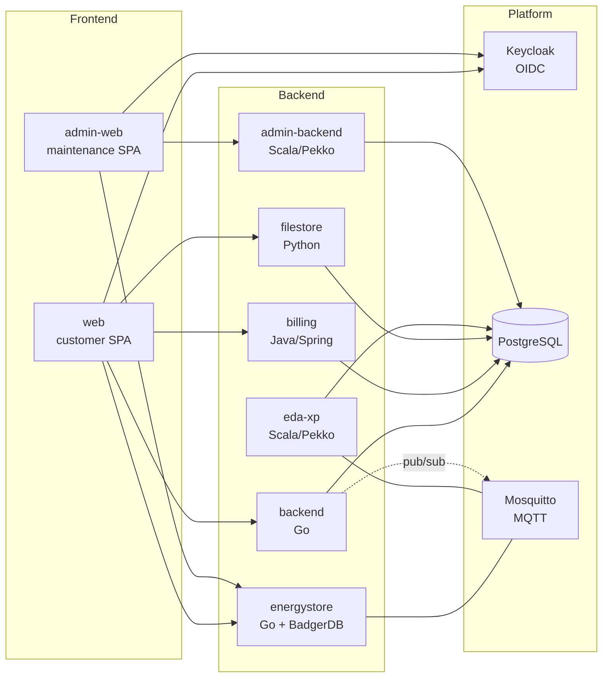

# Service Overview

The eegfaktura platform is a microservice stack that manages member master data, drives the EDA lifecycle of members and metering points (register, activate, deactivate, change participation factor), and ingests the per-period allocations computed by the Austrian network operator. The network operator owns the allocation math — eegfaktura stores the resulting values and uses them to produce billing documents.

## Service topology

## Service tiers

The local stack defines **13 services** (see `docker-compose.yaml`; plus a one-shot `eegfaktura-volume-permissions` helper that chowns the data volumes to UID/GID 1000), grouped into three tiers below. The Dev-zone `eda-mock` (HTTP echo, no MQTT) is listed for completeness but is **not** part of the compose stack — the stack runs the real eda-xp connector (`eegfaktura-kep`).

### Backend layer — domain APIs

Each backend owns a slice of domain logic and exposes a REST API consumed by the frontends.

| Service | Language | Owns | Detail |
|---------|----------|------|--------|
| **backend** | Go | Master data: participants, metering points (Zählpunkte), EEGs, contracts, tariffs | [services/backend.md](../services/backend.md) |
| **billing** | Java / Spring | Billing document generation, tariff application, billing-run state | [services/billing.md](../services/billing.md) |
| **energystore** | Go + BadgerDB | Energy time-series storage and per-period reports | [services/energystore.md](../services/energystore.md) |
| **filestore** | Python | Document storage and download endpoints | [services/filestore.md](../services/filestore.md) |
| **eda-xp** | Scala / Pekko | EDA protocol gateway (network operator communication) | [services/eda-xp.md](../services/eda-xp.md) |
| **eda-mock** _(Dev zone only)_ | — (two `traefik/whoami` echo containers, no code of its own) | answers eda-xp's outbound Ponton/KEP calls with HTTP 200; no responses, no MQTT | [services/eda-mock.md](../services/eda-mock.md) |
| **admin-backend** | Scala / Pekko | Superuser maintenance API (realm role `superuser`): EEG registration, Keycloak users, cross-instance maintenance | [services/admin-backend.md](../services/admin-backend.md) |

### Frontend layer — SPAs

Single-page applications served by Caddy. Both authenticate against the same Keycloak realm but talk to different backends.

| Service | Audience | Detail |
|---------|----------|--------|
| **web** | Community members and EEG admins | [services/web.md](../services/web.md) |
| **admin-web** | VFEEG maintenance operators (cross-instance) | [services/admin-web.md](../services/admin-web.md) |

### Platform layer — infrastructure

Stateful dependencies, deployed alongside the application services.

| Service | Role | Detail |
|---------|------|--------|
| **keycloak** | OIDC identity provider, single realm `EEGFaktura` | [services/keycloak.md](../services/keycloak.md) |
| **postgres** | Relational database (custom image); one `eegfaktura` DB with multiple schemas plus a separate `keycloak` DB | [services/postgres.md](../services/postgres.md) |
| **mosquitto** | MQTT broker for EDA inbound messages and energy data | [services/mosquitto.md](../services/mosquitto.md) |
| **postfix** | Mail relay (forwards to an external SMTP relay host) | [services/mailpit.md](../services/mailpit.md) |
| **proxy** | Caddy reverse proxy (host ports 8001 customer SPA / 8002 admin SPA) | — |

## Request flow examples

### Member views their dashboard

1. **web** loads the SPA from Caddy, redirects to Keycloak for OIDC login.
2. Keycloak issues a JWT with `tenant`, `access_groups`, `email` claims.
3. SPA calls **backend** for master data (participant, EEG settings).
4. SPA calls **energystore** with `X-Tenant` header for the current period's energy report.
5. EEG admins (`EEG_ADMIN`) call **billing** for billing runs and documents; billing answers 403 to members without that group.
6. Each backend independently validates the JWT (backend, energystore and admin-backend against Keycloak's keys, billing and filestore against a locally mounted cert / public key; see [Authentication](auth.md)), then enforces its own tenant / role check.

### Energy data arrives from a network operator

1. PONTON (external EDA adapter) POSTs an XML message to **eda-xp**.
2. eda-xp dispatches the XML to the matching scalaxb-generated handler by message code and version.
3. Handler enriches the message with stored conversation state from prior outbound requests.
4. eda-xp publishes the result to **mosquitto** under `eda/response/<receiver>/protocol/<process>` (`<receiver>` = the community's RC/CC/GC number, lower-cased).
5. **backend** subscribes to the relevant protocols and updates state in PostgreSQL.
6. For energy data (`cr_msg`), **energystore** subscribes to `eda/response/+/protocol/cr_msg`, persists the time-series and publishes `cr_msg_history`, which the backend writes to the process history.

See [Messaging](messaging.md) for the full inbound pipeline.

### Admin runs the period billing

The billing period is configurable per EEG — monthly, quarterly, biannual, or yearly (see `base.eeg."settlementInterval"`: `MONTHLY` / `QUARTER` / `BIANNUAL` / `ANNUAL`). The same flow runs once per chosen period.

1. **web** (EEG admin) calls **billing** to create a preview.
2. The request carries the network-operator-allocated values: **web** reads them from the **energystore** report and sends them as `allocations` (for time-variable tariffs per window bucket `BASE`/`T1`/`T2`). billing has no outbound HTTP client; it reads master data and tariffs from the backend view `base.billing_masterdata` in the shared database.
3. The run is **asynchronous**: `POST /api/billing` answers `202 Accepted` with a `billingRunId`, the UI polls `GET /api/billingRuns/{id}` (a second start for the same period gets `409`).
4. billing applies `verbrauchertarif × G.03` and `erzeugertarif × (G.01T − P.01T)` per metering point (per window bucket for time-variable tariffs).
5. Preview documents (PDFs) are stored by billing itself in `billingj.file_data`; billing does not use filestore.
6. Admin triggers the **final billing** action; the run becomes immutable.

See [reference/obis-codes](../reference/obis-codes.md) for the energy-data semantics, and [services/billing](../services/billing.md) for the run state machine.

### Member-/Zählpunkt-lifecycle operations

Most day-to-day admin work in the customer SPA triggers an EDA process against the network operator. These are asynchronous — the local state moves to an intermediate "requested" state immediately, and the final state is set when the operator's response arrives via the [inbound pipeline](messaging.md).

| UI action | EDA process | Effect |
|-----------|-------------|--------|
| Add member + Zählpunkt | (no EDA) | `base.participant` + `base.meteringpoint` row, status `NEW` |
| Activate Zählpunkt | `EC_REQ_ONL` | `NEW` → `INIT` (request sent) → `PENDING` (operator answer) → `APPROVED` (customer consent) → `ACTIVE` (completion); `REJECTED` / `INVALID` on rejection |
| Offline registration of a Zählpunkt | `EC_REQ_OFF` (`ANFORDERUNG_ECOF`) | offline variant of the registration (`*_ECOF` messages), same state handling as `EC_REQ_ONL` |
| Revoke (deactivate) Zählpunkt | `CM_REV_SP` (backend sends `AUFHEBUNG_CCMS`) | `status` / `process_state` → `INACTIVE`, `inactivesince` = consent end |
| Change participation factor | `EC_PRTFACT_CHANGE` | the operator accepts it only between 09:00 and 17:00 Austrian time and applies it from the next day (outside it rejects with „Prozessdatum falsch“); web warns outside the window but still allows sending |
| Request energy data | `CR_REQ_PT` | operator delivers per-period values (G.01 / G.02 / G.03 etc.) as `DATEN_CRMSG` on the `cr_msg` topic |
| Request metering-point list | `EC_PODLIST` | reconciles the operator-side list of metering points in this EEG |

Revocations also arrive operator- or customer-initiated (`CM_REV_IMP`, `CM_REV_CUS`; `CM_REV_SP` carries both the backend's own request and the answers). They set the metering point's `status` and `process_state` to `INACTIVE` (`database/meteringPointDao.go`). A `REVOKED` process state is defined in `model/participant.go` but not set by the revocation flow.

See [services/backend](../services/backend.md#eda-subscriptions) for the subscription-and-handler mapping.

## Cross-cutting concerns

| Concern | Where it lives | Page |
|---------|----------------|------|
| Authentication | Keycloak realm + per-service JWT verification | [Authentication](auth.md) |
| Database access | One PostgreSQL cluster, schema per service | [Databases](databases.md) |
| Messaging | Mosquitto MQTT, EDA-inbound pipeline | [Messaging](messaging.md) |

## Source repositories

Each service is its own repository. Deployment manifests (Kustomize, synced by ArgoCD) live in `vfeeg-development/eegfaktura-gitops`; platform tooling, zones and ADRs in `vfeeg-development/eegfaktura-platform`.

Service-to-repository mapping is documented per service page under [Services](../services/index.md).
